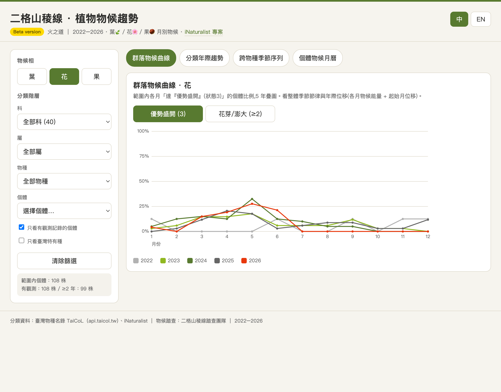
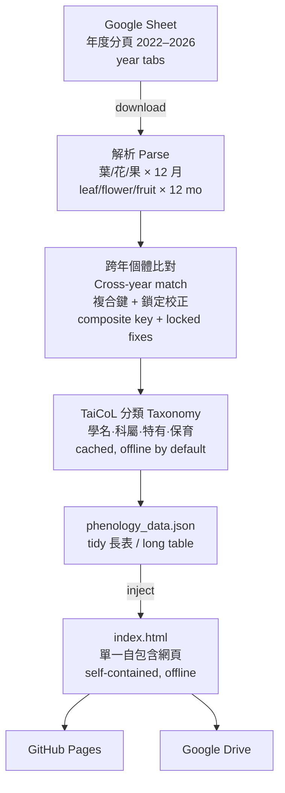

# 二格山稜線 · 植物物候趨勢 ｜ Mt. Erge Ridge · Plant Phenology

火之道（Way of Fire）稜線步道 2022–2026 植物物候踏查的互動視覺化。
An interactive visualization of plant phenology along the "Way of Fire" ridge trail of Mt. Erge (二格山), Taiwan, 2022–2026.

🔗 **Live**: https://bunnytailgra22.github.io/erge-phenology/ ·
🪲 **iNaturalist 專案 / project**: https://www.inaturalist.org/projects/erge-mountain-trail · **Beta**

[English](#english) ｜ [繁體中文](#繁體中文)



---

## Architecture / 專案架構



Data scale: 136 tagged individuals · 5 years · 88 species · 45 families · 14 Taiwan endemics.

---

## English

### Overview
A community survey records the seasonal rhythm — **leaf 🍃 / flower 🌸 / fruit 🌰** — of tagged plants along one ridge trail. This site turns five years of those records into an interactive dashboard for reading seasonal patterns and year-to-year shifts.

### Data model
- One **sheet tab per survey year**; one **row per tagged individual**; columns hold the monthly phenophase state.
- Three phenophases, each scored **1 / 2 / 3** for all 12 months (e.g. flower: 1 = none/ended, 2 = bud/swelling, 3 = full bloom).
- Normalized into a tidy model: one value per **(individual, year, month, phenophase)**.

### Cross-year identity — the core challenge
Tag numbers (編號) are unstable between years (blank, duplicated, re-numbered). Individuals are linked across years by a **composite key** — normalized species name + growth form + trail side + walking order — anchored on the most recent year as the registry. An individual dropped from the latest year keeps its place (flagged `retired`) so its history survives delisting. Auto-match covers 97–99%; alias names are learned from the master sheet itself, and any remaining case can be pinned in `tools/locked_matches.json`.

### Taxonomy
Names are resolved against the **Catalogue of Life in Taiwan (TaiCoL)** — Taiwan-accepted scientific name, family & genus (Chinese + Latin), endemism, and IUCN / national Red List status; **iNaturalist** is the fallback. The dataset carries 14 Taiwan endemics and conservation flags including one Critically Endangered species.

### Dashboard — ten views in three groups
**Field** — for volunteers on and after a survey
1. **This month** — what is happening on the ridge in the latest surveyed month: changes since the last update, plants in flower / fruit, species at peak, data quality.
2. **Coverage** — month × individual grid of which months were recorded, by trail segment.
3. **Individual calendar** — month × year grid per plant, with taxonomy & conservation badges; with no plant selected it lists every plant in scope to pick from.

**Analysis** — trends across years
4. **Community curve** — share of monitored individuals reaching a phenophase each month, 5 years overlaid.
5. **Onset shift** — per species, the onset month of each year and a linear slope (months / year).
6. **Taxon trend** — active span & peak per year; roll up species → genus → family.
7. **Species sequence** — individuals ordered by onset month (the seasonal relay).
8. **Overlap matrix** — which species are active in the same months.

**Reference**
9. **Taxonomy tree** — family → genus → species → individual for the current filters; expand/collapse per node, click an individual to open its calendar.
10. **Methods & codes** — what codes 0–3 mean (v1 and the v2 codebook from 2027), survey dates per year, the crosswalk to USA-NPN / Plant Phenology Ontology, and how blanks are counted.

Filters come in three tiers: **scope** (year / segment / status) applies to every view; **subject** (phase, species search, family, genus, species, form, conservation) sits on each card; **display** options live under ⚙. Active filters show as removable chips and are written into the URL, so a shared link reopens the same view.

Bilingual **中 / EN** toggle (EN shows scientific names + Latin family/genus). Single self-contained HTML — data embedded, **works offline, no backend**.

### Pipeline & updates
`Sheet → parse → cross-year match → TaiCoL taxonomy (cached) → phenology_data.json → injected into the HTML → GitHub Pages`. The whole chain lives in [`tools/`](tools/) and runs as one command:

```bash
python3 tools/build.py path/to/source.xlsx
```

The taxonomy cache is committed, so it normally runs offline in seconds. The build refuses to publish if any observation fails to match the registry, if a species cannot be resolved, or if a completed year loses more than 10% of its values. **A weekly scheduled sync** (Mondays 06:17 Taiwan time) re-runs it against the live sheet, pushes to `main` only when the data changed, and opens a GitHub issue if a check fails or surveys go stale; see [`tools/README.md`](tools/README.md).

### Tech
Vanilla HTML / CSS / JS, hand-rolled SVG charts, no runtime dependencies. Brand palette from the 二格山 visual identity (荒野綠 / 黃 / 紅).

### Data sources & credits
- **Phenology survey**: 二格山稜線踏查團隊 (Mt. Erge Ridge survey team), 2022–2026
- **Taxonomy**: Catalogue of Life in Taiwan — TaiCoL (api.taicol.tw); iNaturalist
- **iNaturalist project**: https://www.inaturalist.org/projects/erge-mountain-trail

### Status & license
**Beta.** Data © the survey team, licensed under [**CC BY-NC 4.0**](https://creativecommons.org/licenses/by-nc/4.0/) — reuse with attribution, non-commercial only. For commercial use, please contact the team.

---

## 繁體中文

### 簡介
社群踏查記錄一條稜線步道上掛牌植物的季節節律 —— **葉 🍃 / 花 🌸 / 果 🌰**。本站把五年的記錄整理成互動式儀表板,用來閱讀季節型態與年際變化。

### 資料模型
- **每個踏查年一個分頁**;**每列一株掛牌個體**;欄位記錄各月的物候狀態。
- 三個物候相,每相 12 個月各記 **1 / 2 / 3**(例:花 — 1 無花/終花、2 花芽/澎大、3 優勢盛開)。
- 正規化為長表:每筆 = **(個體, 年, 月, 物候相) = 狀態值**。

### 跨年個體辨識 —— 核心挑戰
編號跨年不穩定(空白、重複、重新編號)。以**複合鍵**(正規化物種名 + 形相 + 步道左右 + 踏查順序)跨年比對,並以最新年度為主檔。最新年度已除名、但往年留有觀測值的個體會保留下來(標記「已不再追蹤」),歷史不會隨除名消失。自動命中約 97–99%,別名直接從主檔名稱欄學,剩下真的修不好的可寫進 `tools/locked_matches.json` 鎖定。

### 分類
以 **臺灣物種名錄(TaiCoL)** 解析:臺灣接受學名、科與屬(中文 + 拉丁)、特有性、IUCN / 國家紅皮書狀態;**iNaturalist** 為後備。資料含 14 種臺灣特有種,以及保育標記(含 1 種極危 CR)。

### 儀表板 —— 十個視圖,分三組
**現場** —— 給踏查中、踏查後的解說志工
1. **本月** —— 最近一次有踏查的月份山上在發生什麼:與上次更新相比的變動、開花結果株數、達盛期的物種、資料品質。
2. **調查覆蓋** —— 依路段列出各株各月是否有紀錄。
3. **個體物候月曆** —— 每株的 月 × 年 格圖,附分類與保育徽章;未選個體時列出範圍內所有個體可直接點選。

**分析** —— 跨年趨勢
4. **群落物候曲線** —— 各月達某物候相的受監測個體比例,5 年疊圖。
5. **物候期起始位移** —— 各物種每年的起始月份與線性斜率(月/年)。
6. **分類年際趨勢** —— 各年活躍區間與盛期;可由物種上捲到屬、科。
7. **跨物種季節序列** —— 個體依起始月排序的季節接力。
8. **物候重疊矩陣** —— 哪些物種在同樣的月份活躍。

**參考**
9. **分類樹狀圖** —— 目前篩選範圍的 科 → 屬 → 物種 → 個體,可逐節點展開收合,點個體可開啟其物候月曆。
10. **方法與代號** —— 代號 0–3 的意思(v1 與 2027 起的 v2)、各年踏查日、與 USA-NPN / Plant Phenology Ontology 的對照,以及空白怎麼算。

篩選分三層:**範圍**(年度/路段/狀態)全站共用;**主題**(物候相、搜尋物種、科、屬、物種、形相、保育)在各卡片上;**顯示**選項收在 ⚙。已套用的條件以可移除的標籤呈現,並寫進網址,分享連結即可還原同一畫面。

提供 **中 / EN** 雙語切換(英文模式顯示學名與拉丁科屬)。單一自包含 HTML —— 資料內嵌、**可離線、無需後端**。

### 管線與更新
`Sheet → 解析 → 跨年比對 → TaiCoL 分類(快取)→ phenology_data.json → 注入 HTML → GitHub Pages`。整條管線放在 [`tools/`](tools/),一行指令跑完:

```bash
python3 tools/build.py path/to/source.xlsx
```

分類快取跟著版本庫走,平時離線數秒內完成。若有觀測值對不上主檔、有物種查不到分類,或已完成年度的觀測值掉超過一成,會直接擋下不發布。**每週排程自動同步**(週一 06:17 臺灣時間)會對著線上試算表重跑,資料有變動才推上 `main`;把關未通過或踏查資料太久沒更新時會開 GitHub issue 通知,細節見 [`tools/README.md`](tools/README.md)。

### 技術
純 HTML / CSS / JS、手刻 SVG 圖表,無執行時相依。配色取自二格山視覺識別(荒野綠 / 黃 / 紅)。

### 資料來源與致謝
- **物候踏查**:二格山稜線踏查團隊,2022–2026
- **分類**:臺灣物種名錄 TaiCoL(api.taicol.tw)、iNaturalist
- **iNaturalist 專案**:https://www.inaturalist.org/projects/erge-mountain-trail

### 狀態與授權
**Beta 版。** 資料著作權屬踏查團隊,以 [**CC BY-NC 4.0**](https://creativecommons.org/licenses/by-nc/4.0/deed.zh-hant)(姓名標示—非商業性)授權:標示出處即可再利用,限非商業用途。商業用途請與團隊聯繫。
